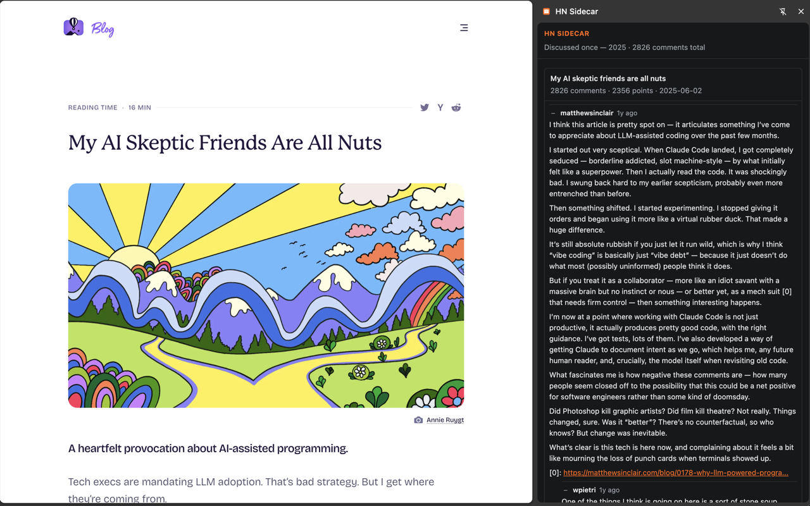

# HN Sidecar

Shows the Hacker News discussion for the page you are on — inline comment threads
in a Chrome side panel, not just a list of links.

HN Sidecar began as an MV3 rewrite of [HNewhere](https://github.com/twalichiewicz/HNewhere)
by Thomas Walichiewicz, used and adapted under the MIT license.



## Privacy

HN Sidecar keeps URL matching client-side. When an HTTP or HTTPS tab finishes
loading, it normalizes and hashes the URL locally and requests one of 16,384
static JSON files using a 14-bit prefix. The downloaded shard's 128-bit digests
are compared locally. The exact page URL and full SHA-256 digest are not sent to
the index service. There are no accounts, analytics, ads, or telemetry.

See the complete [privacy policy](PRIVACY.md).

The extension's only network origins:

- `hn-index.tanner.place` — static shard files and manifests. Requested by shard
  filename (4 hex characters derived from the first 14 hash bits). Cloudflare
  receives standard HTTPS metadata and the shard path, but not the exact URL or
  full SHA-256 digest.
- `news.ycombinator.com` — fetching discussion HTML or prefetching threads you
  click on. Requests use `credentials: omit`, so your HN cookie is never sent. HN
  sees ordinary request metadata for a public page you were about to load anyway.

**What is stored locally:**
- `chrome.storage.session` — recent findings and link maps. Cleared when the
  browser closes.
- IndexedDB (`hn-sidecar`) — cached HN thread HTML. Capped at approximately
  40 MB, with TTLs of 10 minutes for stories under 24 hours old and 30 days
  otherwise.

## Status

- Chrome MV3 extension, works loaded unpacked from `dist/`.
- Index writer (Worker + D1 + R2) is operational on `hn-index.tanner.place`.
- Cloudflare caches shards for six hours and `manifest.json` and `recent.json`
  for five minutes; repeated GET requests return `cf-cache-status: HIT`.

## Limitations

- Chrome 114+ only (MV3). Firefox, Safari, and mobile are not currently supported.
- URL normalization is aggressive on tracking parameters and conservative on
  unknown ones. Some miss rate is inherent — sites rewriting their own paths
  produce non-matching hashes.
- Thread rendering depends on HN's unversioned item-page HTML. Markup changes
  can cause incomplete or failed rendering until the parser is updated.

## Install from source

```bash
git clone https://github.com/vrennat/hn-sidecar.git
cd hn-sidecar

# Install dependencies (uses bun)
bun install --frozen-lockfile

# Typecheck
bun run typecheck

# Run tests
bun test

# Build the extension
bun run build:extension

# Load unpacked in Chrome from packages/extension/dist/
```

## Development

This is a Bun monorepo using workspace packages:

```
hn-sidecar/
  packages/
    extension/   # Chrome MV3 extension
    shared/      # URL normalization, hashing, artifact types
  workers/
    index-writer/ # Cloudflare Worker: HN ingest + shard build
  tools/         # Seed, publish, verification, and measurement CLIs
```

| Command | Purpose |
|---|---|
| `bun install --frozen-lockfile` | Install (CI-safe) |
| `bun run typecheck` | Full project typecheck |
| `bun test` | Run all tests |
| `bun run build:extension` | Build extension into `packages/extension/dist/` |
| `bun run package:extension` | Build the Chrome Web Store ZIP into `packages/extension/release/` |

The current system design is documented in [`docs/architecture.md`](docs/architecture.md).
Chrome Web Store copy, privacy declarations, test instructions, and the submission
checklist live in [`docs/chrome-web-store.md`](docs/chrome-web-store.md).

## Architecture

```
┌─────────────────────┐       ┌────────────────────────────────┐
│  Chrome Extension   │       │  Index Service (Cloudflare)    │
│                     │       │                                │
│  background.js      │       │  Worker (cron /10 min)         │
│    ├─ link-map.ts   │  ──►  │    ├─ ingest → D1 + R2        │
│    ├─ lookup.ts     │  ──►  │    └─ regen → R2 shards       │
│    └─ thread-source │  ──►  │                                │
│                     │       │  R2 (edge-served via CF)       │
│  panel.js           │  ◄──  │    ├─ b/{shard}.json          │
│    ├─ thread.ts     │  ◄──  │    ├─ recent.json             │
│    └─ thread-cache  │       │    └─ manifest.json            │
│                     │       │                                │
│  content-hn.js ────►│  ◄──  │  D1 (raw URLs, never queried  │
│                     │       │      at read time)             │
└─────────────────────┘       └────────────────────────────────┘
```

- **Read path:** 100% static. The extension fetches a shard by filename (14 hash
  bits) and compares a 128-bit truncated digest client-side.
- **Write path:** Worker ingests HN's Firebase stream every 10 minutes, writes
  raw URLs to D1 and hashed shards to R2. No user request reaches this Worker.
- **Link map:** HN page content scripts report stories the user is already
  looking at, producing zero-lookup badges for followed links.

## Hosted vs. self-hosted

The public index at `hn-index.tanner.place` is the default. To self-host:

1. Replace `INDEX_ORIGIN` in `packages/extension/src/config.ts`.
2. Update the `host_permissions` entry in `packages/extension/manifest.json`.
3. Provision a Cloudflare D1 database, R2 bucket, and Worker.
4. For a new database, apply `db/schema.sql`.
5. For an existing database that predates the `refreshed_at` column, run:
   ```
   ALTER TABLE stories ADD COLUMN refreshed_at INTEGER NOT NULL DEFAULT 0;
   CREATE INDEX IF NOT EXISTS stories_refreshed_at ON stories (refreshed_at, ts);
   ```
6. Deploy the index-writer Worker.

The UUID in `workers/index-writer/wrangler.jsonc` (D1 database_id) is an
account-specific database identifier, not a secret. It is committed because it
identifies a resource, not authenticates to one.

## Disclaimer

This project is not affiliated with Hacker News, Y Combinator, or any of their
affiliates. HN Sidecar is an independent open-source tool that uses HN's public
Firebase API and item pages.

## License

MIT — see [LICENSE](LICENSE). Portions are adapted from HNewhere; its copyright
and MIT notice are retained.
